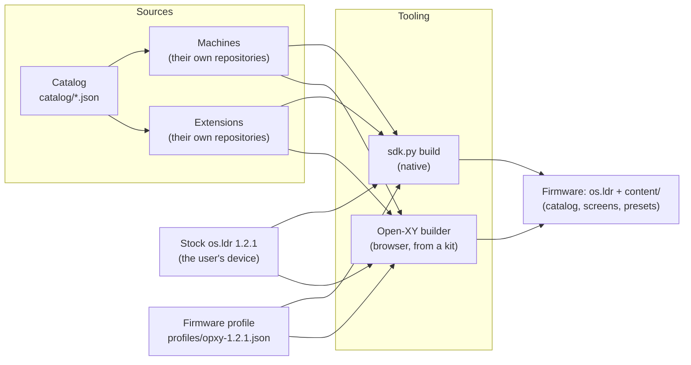
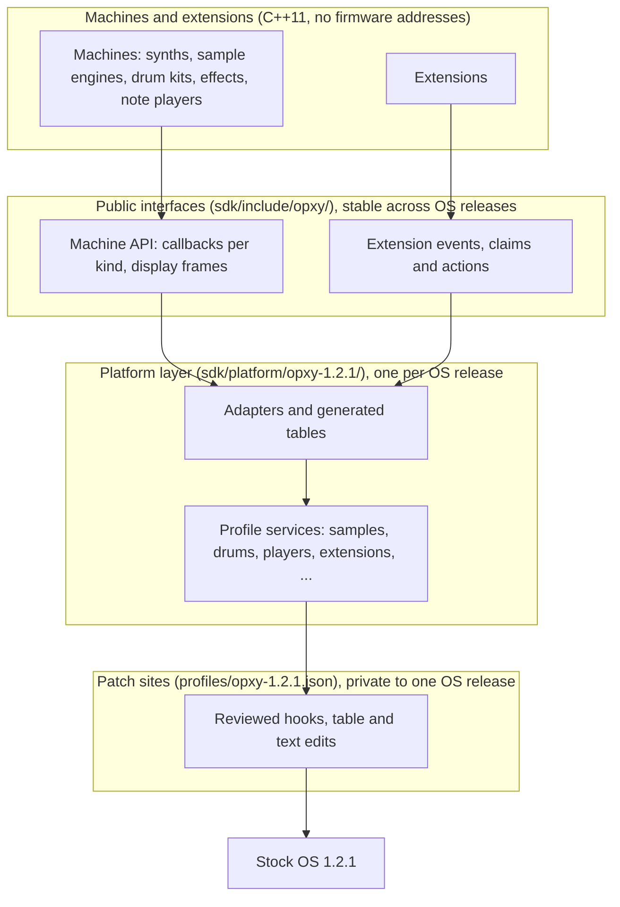
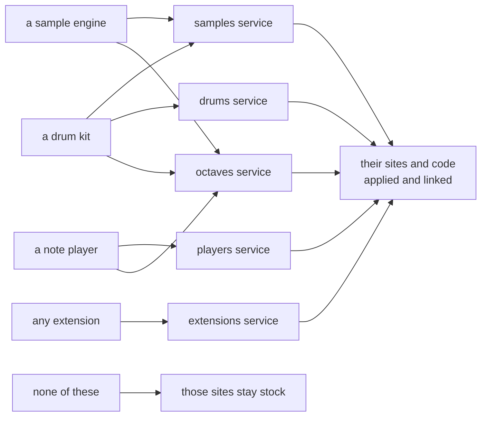
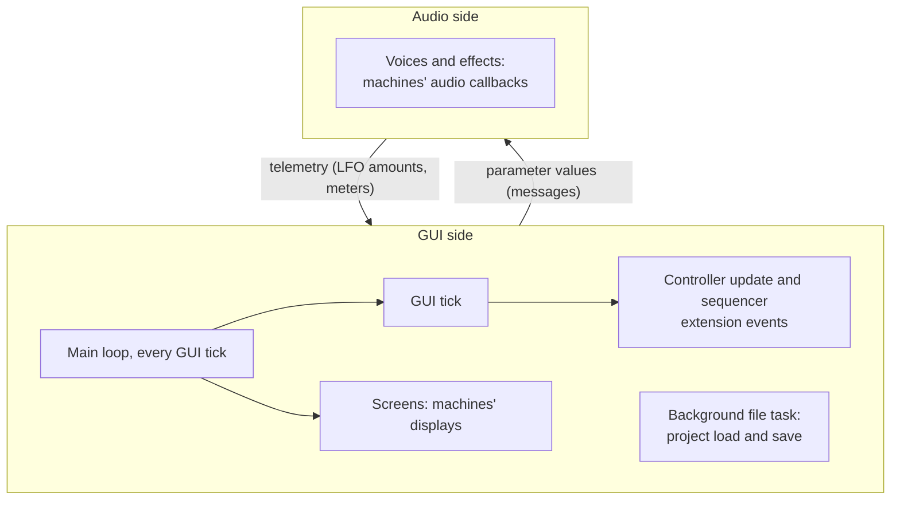
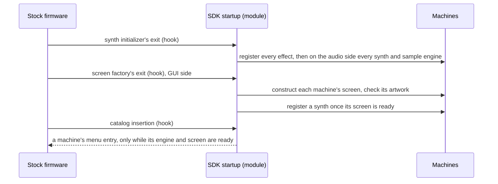

# Architecture

How the SDK is put together: what a build is made of, how machines and
extensions reach stock firmware, and where new work belongs. It is an overview
that links to the pages owning each part; read it before changing the SDK
itself. Machine authors need only [your first machine](first-machine.md) and
the [machine API](api.md).

## From sources to firmware

A build combines the user's own stock OS with a collection of machines and
extensions, each from a repository of its own. It never ships firmware: every
image starts from the `os.ldr` on the user's OP-XY.

- **Native builds** (`sdk.py build`, [building firmware](build.md)) compile the
  collection with the pinned Blackfin [toolchain](toolchain.md) and package it.
- **The browser builder** ([Open-XY](builder.md)) links a precompiled kit of
  catalog machines in the browser, for the selection a user picks.
- Both read the same [firmware profile](../profiles/opxy-1.2.1.json), whose
  digest each pins, so they apply exactly the same edits.

A build links every selected machine and extension into one **module**, placed
in a 2 MiB reservation taken from stock's heap. Everything else in the image
stays byte for byte stock, except the edits the profile reviews
([what a build changes](abi-1.2.1.md#what-a-build-changes)).

## Layers

The SDK keeps the firmware's internals away from machine and extension code.
Four layers, each depending only on the one below:

1. **Patch sites** are the places where stock code calls into the module:
   hooks, plus a few table and text edits. They belong to one OS release and are
   reviewed byte for byte; the SDK owns every site, each exactly once, and a
   build rejects two edits that overlap.
2. **The platform layer** turns those sites into something usable: adapters
   that speak stock's data structures, the tables a build generates for its
   machines, and the services below. Porting to a new OS release moves this
   layer and the profile ([porting](porting.md)); nothing above changes.
3. **Public interfaces** are what contributors write against: the
   [machine API](api.md) and [display API](display.md), and the
   [extension](extensions.md) events, claims and actions. They outlive an OS
   release.
4. **Machines and extensions** are ordinary C++11, with no firmware addresses,
   assembly, platform conditionals or OS headers.

[Firmware extensions](extensions.md#how-the-sdk-exposes-the-firmware) describes
the same split from the side of events: sites, events, subscribers.

## Profile services

A **profile service** groups the patch sites and SDK code one feature needs.
A build applies a service's edits, and links its code, only when a selected
machine or extension needs it; otherwise those sites stay stock. The profile
names each service and what turns it on: the machine kinds that use it, or
`extension` when the build includes an extension.

[`tooling/native.py`](../tooling/native.py) chooses the services from the
selection (`service_users`) and the units each one links (`UNIT_SERVICES`);
the browser builder does the same from the kit. A feature that needs new sites
adds a service, or extends the one it belongs to, rather than editing builds
that don't use it.

"Service" also has a narrower meaning in the [machine API](api.md#services):
the optional resources a sample engine declares in `definition.json`. Those are
features of one machine; profile services are groups of firmware edits.

## At runtime

Stock firmware runs in two roles that exchange messages: the **audio side**
renders voices and effects, and the **GUI side** runs the screens, the
controls and the sequencer.

- **Audio callbacks** (a voice's render, an effect's process) run on the audio
  side: bounded, with no allocation, blocking, logging, I/O or graphics.
- **Displays and extension events** run on the GUI side. Extension callbacks run
  on the controller path, in collection order ([events](extensions.md#events)).
- **Projects** load on stock's background file task, not in the GUI's main
  loop, while the loaded project isn't in use yet. Code that reacts to a load
  records what it needs there and acts on the next GUI tick
  ([project companions](abi-1.2.1.md#project-companions)). Treat saving the same
  way: it goes through stock's file layer too.
- **Values reach the audio side as messages.** The GUI side keeps each track's
  stored parameters (what a project saves) and live parameters (what plays,
  after locks and sequencing), and publishes live values to the audio side when
  they change.

## Machines and extensions

| | Machine | Extension |
| --- | --- | --- |
| What it is | A sound or a source of notes on a track: synth, sample engine, drum kit, send effect, note player | A change to how the OP-XY itself behaves: recording, controls, the sequencer |
| Where it lives | On a track, chosen per pattern like a stock engine | Firmware-wide, in every project |
| What it supplies | Callbacks for its kind, a display and artwork ([API](api.md)) | Event callbacks (`Hooks`) and an `extension.json` ([extensions](extensions.md)) |
| How it acts | Through its kind's callbacks | Through actions it has permission for, inside a claim |
| Saved with a project | Its parameters, as stock saves an engine's | Nothing yet |
| Draws | Its own page | Nothing yet |
| Example | [2op FM](https://github.com/etcetc000/open-xy-core-machines/tree/main/machines/fm2op) | [Capture](https://github.com/etcetc000/open-xy-core-machines/tree/main/extensions/capture) |

Both reach builds through the [catalog](catalog.md) and are chosen in the
builder; a build lists its extensions after its machines, which is also the
order of their callbacks.

## Startup

The details, including the startup label and the catalog, are in the
[firmware contract](abi-1.2.1.md#startup).

## Changing the SDK

- **A new machine** never changes the SDK; it lives in its own repository
  ([your first machine](first-machine.md)).
- **A new capability for machines** adds to the public interface, an adapter in
  the platform layer, and, if it needs stock to call new code, sites in the
  profile, grouped as a service that only its users turn on.
- **A new capability for extensions** reuses or widens an event before adding
  one, and adds claims and actions to the registry
  ([changing the SDK for an extension](extensions.md#change-the-sdk-for-an-extension)).
- **A new site** is reviewed against stock byte for byte, and must not overlap
  another; sites are private, so a public interface never names one.

Keep the docs at their owning layer: this page links rather than repeats them.
When a change adds a layer, a service or a runtime path, update the diagrams
here.

## Glossary

| Term | Meaning |
| --- | --- |
| Machine | A synth, sample engine, drum kit, send effect or note player, built from its own repository |
| Extension | Firmware-wide behavior built from its own repository, driven by events |
| Module | The selected machines, extensions and SDK code, linked together into the reservation |
| Profile | [`profiles/opxy-1.2.1.json`](../profiles/opxy-1.2.1.json): stock hashes, the reservation, identity ranges and every reviewed edit |
| Site, hook | A place in stock code that calls into the module; a hook replaces a reviewed call or jump |
| Profile service | A group of sites and SDK code applied only when a selected machine or extension needs it |
| Event | A public callback that something happened in stock, delivered to extensions |
| Claim | An exclusive gesture on a key, owned by one extension per build |
| Action | Permission to change stock state, granted inside a claim |
| Kit | A precompiled collection the browser builder links from |
| Role (side) | Where code runs: the audio side or the GUI side |
